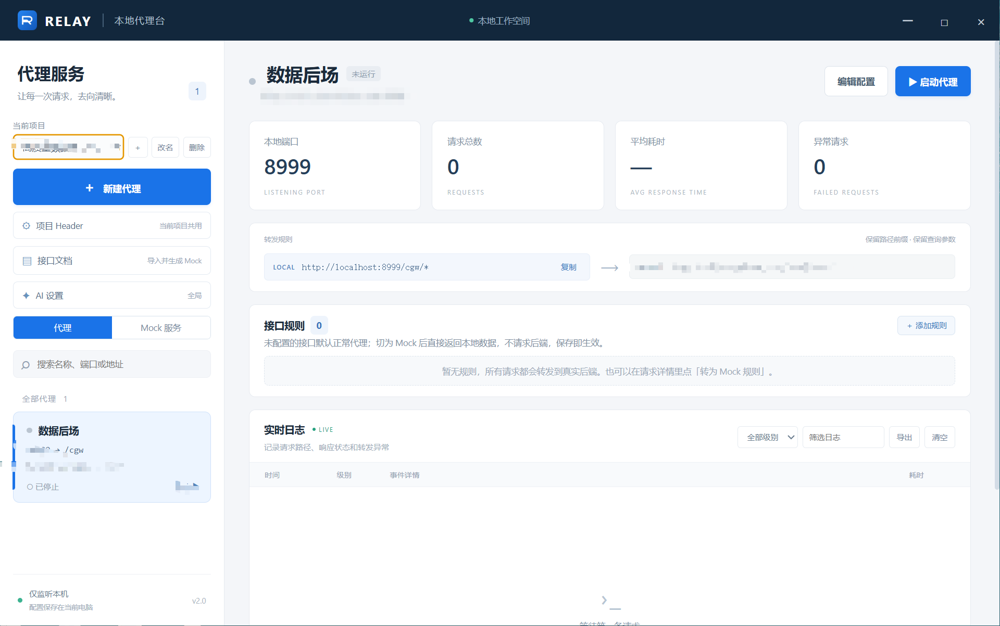
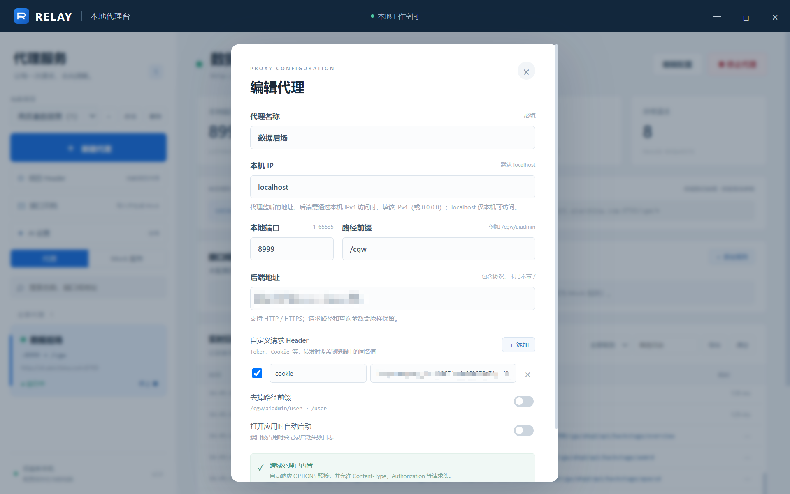
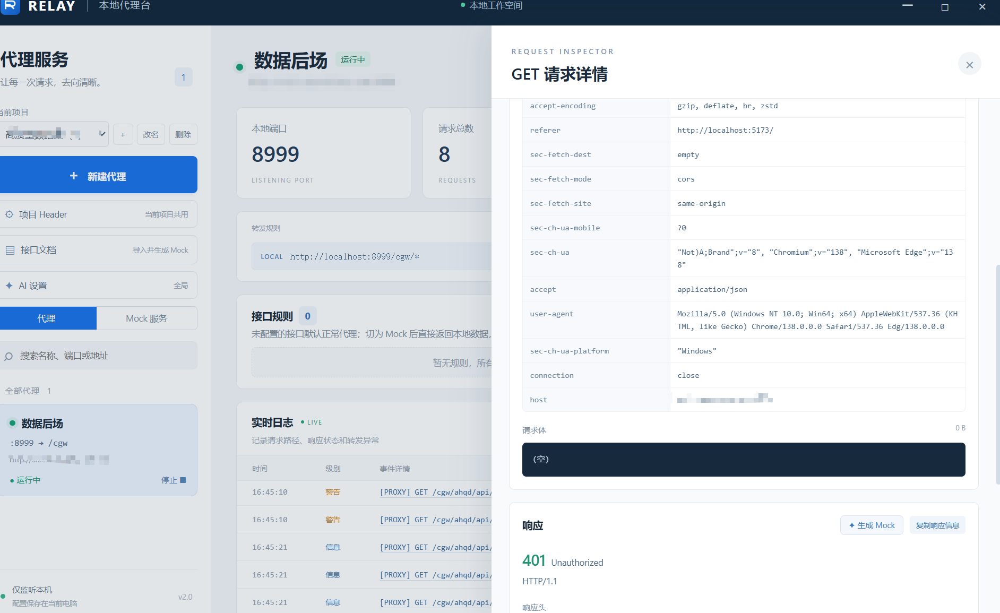
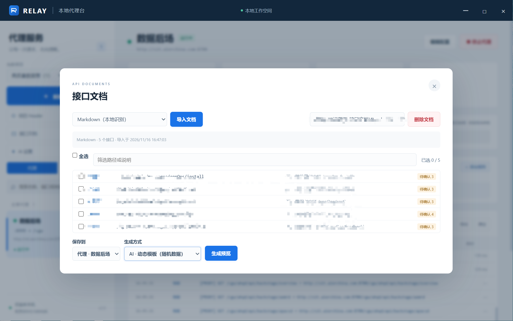
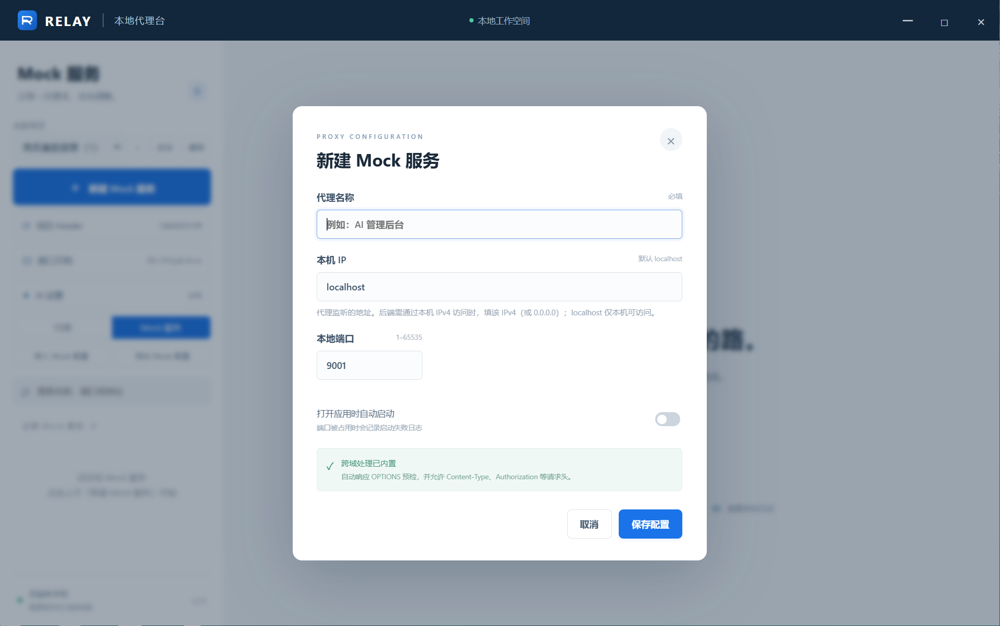
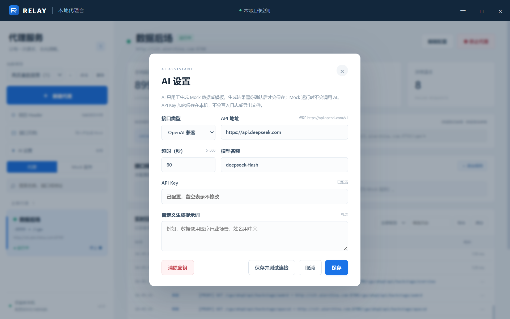

# Relay 代理台

> 给本地开发，一条清晰的路。

Relay 是一个面向前端开发的**桌面本地代理管理器**（Electron）。它把「本地起代理解决跨域」「看清每个请求发了什么、回了什么」「后端没好之前先用 Mock 顶上」这几件日常琐事放进一个界面里——不用改代码，也不用记命令。



## 功能特性

### 多代理 · 跨域内置
- 同时管理多个代理，每个代理独立的**本地端口**、**后端地址**、**路径前缀**（可选择转发时去掉前缀）。
- **多环境**：一个代理可配置多个后端地址（如 测试 / 预发 / 生产），在详情页下拉框一键切换，运行中立即生效、无需重启；只切换后端地址，Header 与接口规则不随环境变化。
- **接口调试**（类似 Apifox）：在接口规则里点「调试」，选环境、自定义路径参数 / Query / Header / Body，发送真实请求并查看后端的状态码、响应 Header 和 Body；会自动带上代理与项目 Header（可关闭），即使该接口当前被 Mock 也能拿到后端的真实数据。代理不需要启动。
- 跨域处理开箱即用：自动响应 `OPTIONS` 预检；带 Cookie / `withCredentials` 的请求会回写具体 Origin 和 `Access-Control-Allow-Credentials`。
- 可监听 `localhost`（固定绑定 `127.0.0.1`）或指定本机 IP / `0.0.0.0`，方便手机等局域网设备调试。
- 支持「打开应用时自动启动」；端口冲突时记录启动失败日志。

### 请求链路与实时日志
- 实时显示每条请求：方法、路径、状态码、耗时，以及请求总数、异常请求、平均耗时统计。
- 请求详情可查看**实际发送**的请求头 / 请求体与响应头 / 响应体，自动解压 gzip / deflate / br，JSON 一键格式化。
- `Authorization`、`Cookie` 等敏感 Header 默认遮挡；日志最多保留最近 5,000 条，可导出为文本。

### 公共请求头
- **项目 Header**：作用于当前项目的所有代理，例如统一注入 Token、Cookie。
- **单代理 Header**：只作用于某个代理，同名时覆盖项目 Header。
- 转发时覆盖浏览器中的同名值；保存后对运行中的代理立即生效，无需重启。

### Mock
- **接口级切换**：代理下未配置的接口照常转发；某个接口切为 Mock 后直接返回本地数据，不再请求后端，保存即生效。
- **路径匹配**：支持 `/users/:id` 路径参数与末尾通配 `/files/*`，方法可选 `ANY`。
- **多场景**：同一接口最多 20 个场景（如「正常」「空列表」「500 报错」），各自独立的状态码、Header、Body、延迟，一键切换。
- **独立 Mock 服务**：不依赖任何后端，单独占一个端口，纯 Mock。
- **从真实响应生成**：在请求详情里点「把这次响应生成为 Mock」，可选固定样例、本地动态模板或 AI 生成。
- **导入 / 导出**：Mock 配置可导出为 JSON 与同事共享；导出文件**不含**代理地址、项目 Header 等可能带令牌的信息。

### 动态数据（占位符）
开启「动态数据」后，Body 中的占位符在每次请求时渲染成不同的值，纯本地运行，不依赖 AI：

```json
{
  "list": [
    "{{repeat 3 8}}",
    { "id": "{{seq}}", "name": "{{name}}", "phone": "{{phone}}", "age": "{{int 18 60}}", "gender": "{{pick 男 女}}" }
  ],
  "page": "{{query.page}}",
  "userId": "{{params.id}}"
}
```

| 占位符 | 说明 |
|---|---|
| `{{uuid}}` | UUID |
| `{{int 最小 最大}}` / `{{float 最小 最大 小数位}}` | 随机整数 / 小数 |
| `{{bool}}` | 随机布尔 |
| `{{name}}` `{{phone}}` `{{email}}` `{{city}}` | 中文姓名、手机号、邮箱、城市 |
| `{{text 字数}}` | 随机中文文本 |
| `{{date 起 止}}` / `{{datetime 起 止}}` | 相对今天偏移若干天的日期 / 时间，如 `{{date -30 0}}` |
| `{{timestamp}}` | 当前毫秒时间戳 |
| `{{pick A B C}}` | 从选项中随机取一个 |
| `{{seq [起始值]}}` | 自增序号（跨请求保留） |
| `{{params.xxx}}` / `{{query.xxx}}` | 引用路径参数 / 查询参数 |
| `{{repeat 最少 最多}}` | 写在数组第一个元素，其后的元素重复生成若干轮 |

整个字符串值恰好是一个占位符时会保留类型（`"{{int 1 9}}"` 输出数字 `5`）；夹在文字中间时输出文本（`"编号-{{int 1 9}}"` → `"编号-5"`）。

### 接口文档导入
- 支持 **Swagger 2.0 / OpenAPI 3.x**（JSON、YAML），解析内部 `$ref` 与 `allOf / oneOf / anyOf`，默认取 2xx 响应生成样例。
- 支持 **Markdown 接口文档**：可本地识别，也可交给 AI 提取；识别不确定的信息会标记出来，由人确认后才生成。
- 批量生成 Mock 前先预览，可逐条修改；与已有接口冲突时可选择跳过或覆盖。

### AI 辅助（可选）
- 支持 **OpenAI 兼容接口** 与 **Anthropic** 两类服务，可配置 API 地址、模型、超时和自定义提示词。
- 用途：把样例改写成动态模板、按文档重新生成 Mock、从 Markdown 提取接口。
- AI 只生成「候选数据」，需人工确认后才保存；**不参与运行时的请求链路**。
- API Key 通过 Electron `safeStorage`（Windows 下为 DPAPI）加密保存，不写入配置文件、日志或导出文件。

### 多项目
- 按项目隔离代理、Mock 服务、项目 Header 与接口文档；端口在所有项目间全局唯一。

## 界面预览

| 代理配置与自定义 Header | 请求详情 |
|---|---|
|  |  |
| **接口文档导入，批量生成 Mock** | **独立 Mock 服务** |
|  |  |
| **AI 设置** | |
|  | |

## 下载

到 [Releases](https://github.com/MrGgao-m/relay-proxy-manager/releases/latest) 下载最新的 `Relay-Proxy-x.y.z.exe`（Windows 便携版），双击即可运行，无需安装。

> 程序未做代码签名，首次运行时 Windows SmartScreen 可能提示「已保护你的电脑」，点「更多信息 → 仍要运行」即可。

## 快速开始

### 环境要求
- Node.js ≥ 18
- Windows / macOS / Linux 桌面环境（主要在 Windows 上使用和验证）

### 从源码运行

```bash
git clone https://github.com/MrGgao-m/relay-proxy-manager.git
cd relay-proxy-manager
npm install
npm start
```

### 打包（Windows 便携版）

```bash
npm run dist
```

产物输出到 `dist/`，文件名形如 `Relay-Proxy-2.1.0.exe`，双击即可运行，无需安装。

### 发布新版本

发布由 GitHub Actions 自动完成（[`.github/workflows/release.yml`](.github/workflows/release.yml)）：

```bash
# 1. 修改 package.json 中的 version，例如 2.1.1，并提交
# 2. 打标签并推送（标签必须与 version 一致）
git tag v2.1.1
git push origin v2.1.1
```

推送标签后，GitHub 会在 Windows 上依次执行测试、打包，并创建对应的 Release、上传 exe。

## 使用示例

假设前端跑在 `http://localhost:5173`，后端在 `http://10.0.7.33:8106`，接口统一以 `/cgw/aiadmin` 开头：

1. 点「新建代理」，填写：
   - 本地端口：`9000`
   - 后端地址：`http://10.0.7.33:8106`（包含协议，末尾不带 `/`）
   - 路径前缀：`/cgw/aiadmin`
2. 点「启动代理」。
3. 前端把接口地址改为 `http://localhost:9000/cgw/aiadmin`，即可跨域访问后端，并在右侧看到实时请求日志。
4. 某个接口还没开发完？在规则里添加该接口并切为 Mock，填好返回数据，保存即生效。

## 数据存储

所有配置只保存在本机 Electron 的 `userData` 目录（Windows 下一般为 `%APPDATA%\relay-proxy-manager\`）：

| 文件 | 内容 |
|---|---|
| `relay-config.json` | 项目、代理、Mock 规则、接口文档、AI 设置（不含密钥） |
| `secrets.json` | 加密后的 AI API Key |

从 v1.2 升级时会自动迁移旧的 `proxies.json`，并保留备份 `proxies.json.v1.2.bak`。

## 项目结构

```
src/
  main.js            Electron 主进程，IPC 入口
  preload.js         渲染进程桥接
  proxy-manager.js   代理 / Mock 服务的启停、转发、日志采集
  rules.js           接口规则：路径匹配、Mock 场景、校验
  template.js        动态数据占位符引擎
  openapi.js         Swagger / OpenAPI 解析
  markdown-doc.js    Markdown 接口文档识别
  sample-gen.js      按 Schema 生成样例数据
  ai.js              AI 客户端（OpenAI 兼容 / Anthropic）
  mock-io.js         Mock 配置导入导出
  store.js           配置读写与版本迁移
  secrets.js         API Key 加密存储
renderer/            界面（HTML / CSS / 原生 JS）
test/                单元测试、IPC 测试、端到端测试
```

## 测试

```bash
npm test          # 纯 Node 测试（node:test），无需图形界面
npm run test:ui:v2  # Electron 界面冒烟测试，需要桌面环境
```

## 技术栈

Electron · Express 5 · http-proxy-middleware · js-yaml · Ajv

## License

[MIT](LICENSE)
